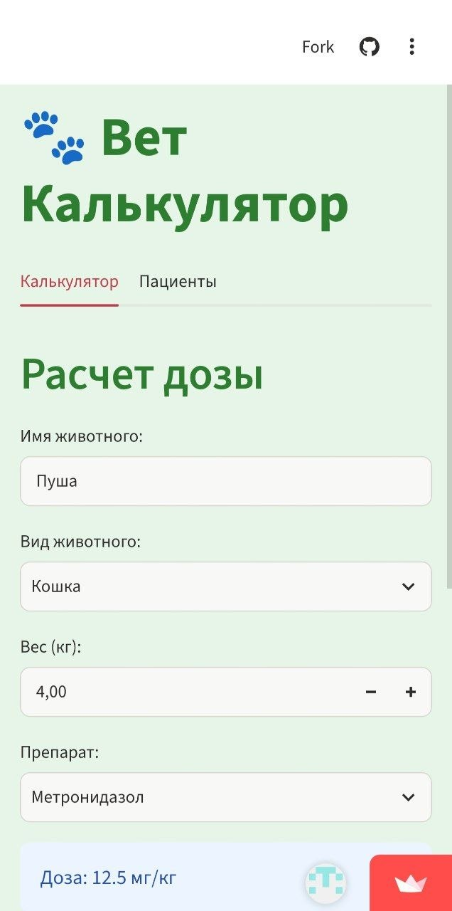
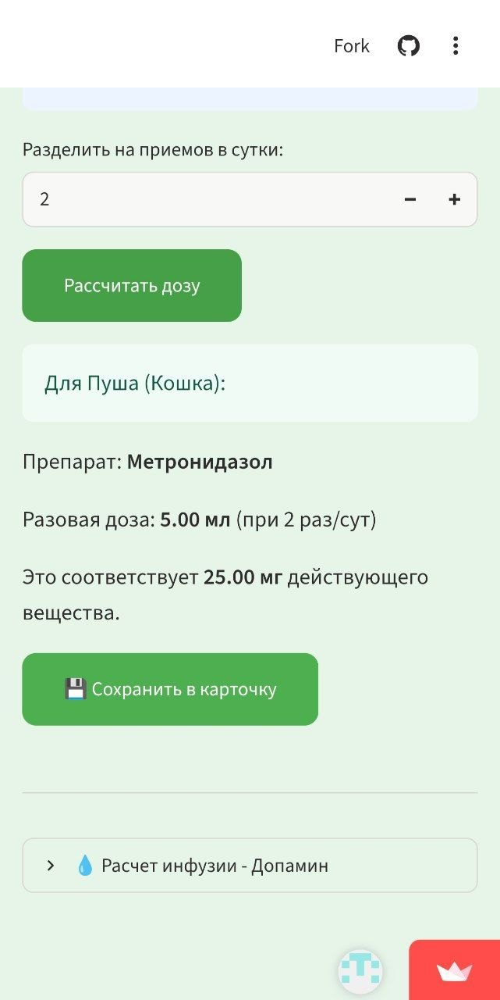
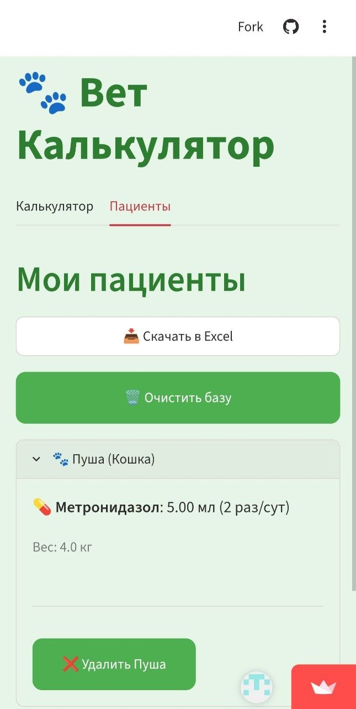
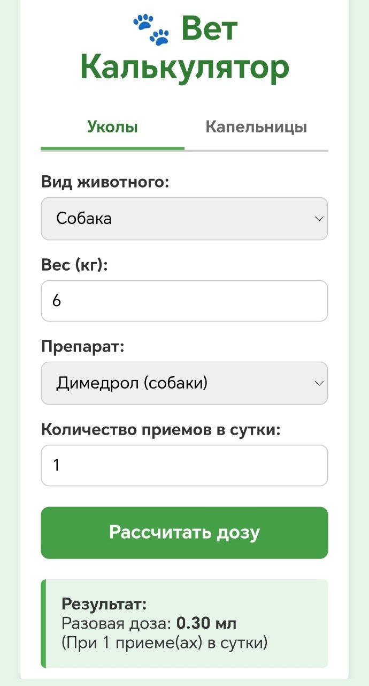

# Clinical Dosing Assistant

## Table of Contents

- [About the Project](#about-the-project)
- [Tech Stack](#tech-stack)
- [Quick Start](#quick-start)
- [Screenshots](#screenshots)
- [What I Did](#what-i-did)
- [About the Clinic](#about-the-clinic)
- [Trade-offs & Challenges](#trade-offs--сhallenges)

### About the Project

This project is an initiative I took for our veterinary clinic. Аfter consulting with the doctors, they identified the most pressing need - a dedicated tool for calculating medication dosages.

I created a dosage calculator that solves three main tasks:
* Fast and accurate calculations: a database of 20+ drugs with different concentrations and automatic unit conversion
* Infusion assistance: a dedicated module for calculating dopamine drip rates
* Offline capability: keeping in mind the unstable mobile internet, I built both the main web version and a standalone HTML calculator for offline use

The clinic's veterinarians have already tested the project and are actively using the app in their daily routine.

### Tech Stack

* Python 3
* Streamlit (web interface)
* SQLite3 (local storage)
* Pandas, OpenPyXL
* Offline version: Vanilla HTML / CSS / JavaScript

### Quick Start

Use the live app:
[Open Vet Dose Calculator](https://vetclinicapp-jnw4kndat3zgfbdxvmg7qr.streamlit.app/)
*(Note: The app is hosted on a free Streamlit Cloud tier. If it hasn't been used recently, the server might be asleep. Just wait ~20 seconds for it to wake up and load.)*

If you **don't have internet access**, download the offline_version/offline_calc.html file from this repository and open it in any web browser. No server or internet connection required.

### Screenshots

| Data Input | Calculation | Patient History |
| :---: | :---: | :---: |
|  |  |  |

The user enters the pet's data (Fig. 1) - name, species (cat/dog), weight, and selects the drug. The program displays the dosage if it is fixed, or suggests selecting a range if it varies. Next (Fig. 2), the user specifies the number of doses per day, and the app calculates the single dose and prompts to save it to the patient's chart. There is a dedicated block for infusion calculations. In the "Patients" tab (Fig. 3), users can export the data to Excel or clear the database.

*Offline version:*

### What I Did

1. Requirement Gathering: interviewed clinic staff to find the idea and gathered initial data on drugs and dosages.
2. Logic & Architecture: implemented unit conversion (mg, mcg, IU) and added dosage selection options for specific drugs (Cordiamine, various forms of GS-441524, Reamberin, etc.). Deployed the app using Streamlit Cloud.
3. Database: proactively implemented a local database to save patient history and added the ability to export data to Excel.
4. Offline Version: created a standalone offline version that works without the internet.
5. Testing: validated the app using mock data and test cases provided by the veterinarians.

### About the Clinic

I decided not to include the clinic's real data here, as this repository is public. However, I have received a recommendation letter from the founder, which I'm providing separately - it contains the clinic's address, names, and contact information.

### Trade-offs & Challenges

Q: **Why didn't you use a cloud database (e.g., Neon or Supabase)?**

A: Many cloud providers are unstable or blocked in Russia. Even if I used a VPN during development, expecting doctors to do the same is unrealistic. Furthermore, mobile internet in the clinic is often unstable, and there is no Wi-Fi yet. A local database is much more reliable. However, I agree that for a full-scale commercial product, a stable cloud database would be necessary.

Q: **But Streamlit regularly wipes temporary files. What happens to your database?**

A: I took this into account. Streamlit Cloud keeps local files for 12–48 hours. Building a full commercial database is overkill here, as the clinic already uses Vetmanager. Creating this small database was my initiative: doctors can save data during the day and then transfer it to Vetmanager or export it as an Excel file. I implemented that export feature as well.

Q: **Your offline version looks a bit hacky. Isn't it?**

A: Yes, it's a compromise. The offline_version folder contains a standalone HTML file. It's not as polished as the Python app, but I created it purely as a fallback for no-internet situations. The main product is great, but useless if it's unavailable when you need it most. Working without internet was a direct request from the clinic.

Q: **What about the privacy of the clinic's data?**

A: The app is hosted on Streamlit Cloud and really has no security layers. The code on GitHub is also public. However, no confidential information is stored: no employee data, no clinic data. Only pet names and their prescribed medications.

Q: **Why didn't you integrate AI/ML? Wouldn't that make your project technically stronger? Don't you think you just made a simple calculator and a page design?**

A: Not at all :) To be honest, I actually considered adding an ML tab with a decision tree or regression, something like this. However, I couldn't find a reasonable use case. I specifically asked the staff what they wanted to see, and the answer was clear: a dosage calculator. The drug list is fixed, so there's not much room for ML. I thought about linking weight, age, and prescribed drugs to predict potential diseases - it sounds cool but is useless in practice. The doctors determine that without my help. All the ideas I considered were overengineered and went far beyond the actual request. Plus, most public vet datasets are in English, which doesn't help here. In the end, I settled on a relatively simple but highly practical project. It might not showcase me as a data scientist, but it shows me as a pragmatic engineer.

Q: **How did you test the app? A dosage error can be dangerous for an animal.**

A: I asked the doctors for test cases (mock data) for a fictional pet and cross-referenced their manual calculations with the program's output.
